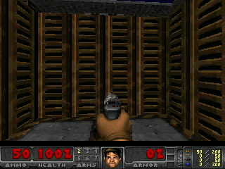

# APDO — DOOM on KM003C

[English（メイン）](README.md) · [日本語](README.ja.md)

> 本プロジェクトは、EPR（Extended Pixel Range）規格に準拠し、高負荷な戦闘シーンでは AVS（Adjustable Violence System）によって暴力描写とフレームレートを100mHz単位で動的に最適化。最終的に APDO（Augmented Power DOOM Object）としてKM003Cの画面へ出力される――

*上記のEPR・AVS・APDOはUSB-PD用語にかけたジョークです。実装は約6fpsで動くネイティブDOOM移植です。*

**POWER-Z KM003CでDOOMが動きました。** 正確には、省メモリ版DOOMエンジンでFreedoomのE1M1を実行します。PCはビルド・書き込み・検証に使い、ゲーム処理はKM003C本体のMCUで行います。



*320×240のホスト検証画像で、実機写真ではありません。本体には240×180へ縮小して表示します。*

## 動作状況

| 項目 | 確認結果 |
| --- | --- |
| 実機 | POWER-Z KM003C HW2.3の1台、元ファーム2.0.7 |
| 実行環境 | Cortex-M4 / HC32F460、192MHz |
| ゲーム | Freedoom 0.13.0、E1M1 |
| 表示 | 240×240液晶の中央に240×180で表示 |
| 速度 | 1フレーム約171～173ms、約6fps |
| 操作 | 前進・旋回・射撃・扉／スイッチ・メニュー |
| PC操作 | USB経由のブラウザー操作パネル。実機で移動・旋回・射撃を確認 |
| PCプレビュー | v6で液晶への描画を120×90・RGB565でキャプチャ。画像保存にも対応 |
| 起動 | 約3秒で自動起動。HID抜き挿し後の起動と操作を実機確認 |
| 復旧 | 純正アプリと外部NOR全4MiBの復元・読み戻し・純正起動を実機確認 |

音声、セーブ、設定保存、別マップへの遷移は今回の対応範囲外です。DOOM版では測定・PDタスクを起動しません。側面HID端子から給電し、測定側の端子には機器を接続せず使用します。

動作確認したのは**1個体のみ**です。HW2.3全個体の互換性を保証するものではありません。更新時には個別に保存したローダーとの完全一致を要求します。純正ファーム、ローダーダンプ、校正データ、シリアル番号、コンパイル済みファームは公開リポジトリに含めません。

## 操作方法

| 操作 | ボタン |
| --- | --- |
| 前進 | OK |
| 旋回 | 左 / 右 |
| 射撃 | Exitを短く押す |
| 扉・スイッチ | 左＋右 |
| メニューを開く | Exit＋OK |
| メニューの上下 | 左 / 右 |
| メニューの決定 / 戻る | OK / Exit |
| 自動起動を止めてUSB保守待機 | 起動時にOKを押す |
| 純正更新画面へ戻る | Exitを約2秒押す |

Exitを押したままHIDケーブルを接続しても、アプリのUSB動作に依存せず純正更新／DFU画面へ入れます。

### PCから操作する

PC操作対応版（v5）と更新したホストを用意して、次を実行します。

```powershell
.\scripts\play.ps1
```

開いたローカル操作パネルで **Enable keyboard** を押します。**WASD／矢印**で移動・旋回、**Space／Ctrl**で射撃、**E**で扉・スイッチ、**Esc**でメニュー、**Enter**で決定です。タブを切り替えると入力を解除し、戻った後は再びEnableを押します。ゲーム画面は本体に表示します。詳細は[PC操作ガイド（英語）](docs/PC-CONTROLS.md)を参照してください。

v6では同じパネルに **120×90・RGB565の実機画面プレビュー**も表示します。**Save frame** でBMP画像を保存できます。解像度、RAM使用量、更新速度の制約は[画面キャプチャの説明（英語）](docs/SCREEN-CAPTURE.md)に記載しています。

## ソースとビルド

検証環境はWindows、PowerShell、Python 3、Rust Windows GNU、LLVM-MinGWです。[SOURCE_LOCK.json](SOURCE_LOCK.json) の固定リビジョンに、管理対象のパッチと追加ソースを適用します。

```powershell
git clone https://github.com/inuchanbt/apdo-doom-on-km003c.git
cd apdo-doom-on-km003c
python scripts/prepare-sources.py --sources-only
```

ここまではUSBにアクセスせずソースを再構成するだけです。実機更新用ホストのビルドには、**自分の個体で事前に検証した復旧データ**と、Git対象外の `local/device.json` が必要です。環境構築、Freedoom変換、ビルドは[ビルド手順（英語）](docs/BUILD.md)を参照してください。

```powershell
.\scripts\build-host.ps1
.\scripts\build-firmware.ps1
```

この2つのコマンドは実機へ書き込みません。汎用インストーラーや、書き込み済みイメージの配布はありません。

## 純正への復旧

検証した手順は、元の外部NORを復元して全4MiBを読み戻し、純正アプリを書き戻し、ローダーが不変であることと純正起動を確認します。外部NOR末尾1MiBはゲームサービスから書き込めません。

元の作業フォルダーに検証済みバックアップと設定を残した状態で実行します。

```powershell
.\scripts\restore-stock.ps1
```

詳細は[復旧手順（英語）](docs/RECOVERY.md)に記載しています。GitHubからのcloneには復旧データが含まれません。元の作業フォルダーを残し、バックアップを別の場所にも保管してください。

[検証記録（英語）](docs/VALIDATION.md)では、実機確認・ホスト描画・ビルド検査を分けて記載しています。実機でのゲーム操作と、外部データを含む純正復元まで確認済みです。

## ディレクトリ構成

| パス | 内容 |
| --- | --- |
| `native/` | Cエンジン接続部分とホスト検証環境 |
| `overlays/` | 追加したRustソース |
| `patches/` | 固定版の上流ソースに適用する差分 |
| `scripts/` | ソース復元・ビルド・検証・復旧 |
| `web/` | ローカルのキーボード・マウス操作パネル |
| `docs/` | 詳細手順と検証記録 |
| `notices/` | Freedoomのライセンスとクレジット |
| `vendor/`, `tools/` | ローカルの依存ソースとツール、Git対象外 |
| `local/`, `backups/`, `artifacts/` | 個体設定・バックアップ・生成物、Git対象外 |

## 謝辞・ライセンス

- [okhsunrog/km003c-firmware](https://github.com/okhsunrog/km003c-firmware)：基板対応、Rustファーム、ホストツール、純正ローダー経由の更新・検証。
- [ArturBieniek4/DMC100-Doom](https://github.com/ArturBieniek4/DMC100-Doom)：省メモリDOOMエンジンとゲームデータ変換。
- [doomgeneric](https://github.com/ozkl/doomgeneric)、id Software：DOOMエンジンの上流。
- [Freedoom](https://freedoom.github.io/)：ゲーム素材。有償DOOMのIWADは含みません。
- [r/UsbCHardwareのカスタムファーム投稿](https://www.reddit.com/r/UsbCHardware/comments/1xhtny5/running_custom_firmware_on_my_powerz_km003c/)：今回の実験のきっかけ。

別途記載がない本プロジェクト独自の資料・コードは既存の[MITライセンス](LICENSE)を適用します。Cエンジン接続部分とDMC100-Doomの変更部分はGPL-2.0-or-laterで、本文は[COPYING](COPYING)に保存しています。上流のライセンス条件は引き続き適用されます。詳細は[THIRD_PARTY_NOTICES.md](THIRD_PARTY_NOTICES.md)を参照してください。
