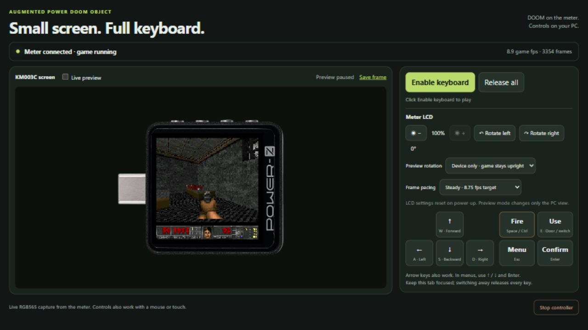

# APDO DOOM — 独立ファームウェア版

[English (main)](README.md)

本プロジェクトは **EPR（Extended Pixel Range）** 規格に準拠し、高負荷な戦闘シーンでは
**AVS（Adjustable Violence System）** によって暴力描写とフレームレートを100mHz単位で動的に最適化。
最終的に **APDO（Augmented Power DOOM Object）** としてKM003Cの画面へ出力される――。
（USB-PD用語を使ったジョークです。）

`main` はKM003C向けの独立DOOM専用ファームウェアです。
**実験版ファームウェアをPre-releaseで公開しています。** 旧v8とそのツールは
[legacyブランチ](https://github.com/inuchanbt/apdo-doom-on-km003c/tree/legacy)に保存しています。
既存の作業環境を更新する場合は[ブランチとツールの移行案内](docs/BRANCHES.md)を参照してください。

## ダウンロードとリスク

[独立版 v0.1.2-independent — HW 2.3 をダウンロード](https://github.com/inuchanbt/apdo-doom-on-km003c/releases/tag/v0.1.2-independent)。
Windows x64用ZIPの `START-HERE.md` を開いてください。
ファーム・対応HID用PCツール・Freedoom E1M1データが入っています。
対応する全ソースは同じReleaseの `-source.tar.gz` に添付しています。

新版の対象は純正FW 2.0.7の **HW 2.3** です。
[従来のv0.1.1 HW 2.1試験版](https://github.com/inuchanbt/apdo-doom-on-km003c/releases/tag/v0.1.1-independent)は別途残しています。
その修正前の試験版では協力者のHW 2.1の1台でゲームが動きました。
[実機確認の範囲](docs/VALIDATION.md#hw21-gameplay-report)を参照してください。

**導入により本体が永久に使用不能になったり、工場出荷時のデータを失う可能性があります。
復旧は保証できず、修理・買い直しが必要になることもあります。**

- 純正FW 2.0.7とハードウェア版に合うインストーラーを使ってください。照合に失敗した場合は中止してください。
- 純正アプリをDOOM専用アプリに置き換えるため、**導入中はUSB測定・PD交渉・純正テスターUIを使えません**。
- ゲーム導入で外部NORの先頭3MiBを書き換えます。**ファーム書き込み前に自分の個体の純正／DFU取得・検証と
  純正復旧パッケージ作成を済ませ、ゲームデータ書き込み前に元の外部NOR全4MiBを取得・検証**してください。
- 純正復帰には元のNOR内容と元のアプリの両方を、手順書の順序で戻す必要があります。
  純正アプリのファイルだけでは完全な復旧になりません。
- 書き込み中断・不具合・ハード違い・バックアップの取り違えにより復旧不能になることがあります。
  **2026-10-31に所有者が同じHW2.3個体で、新手順による初回導入・ゲームデータ書き込みから完全な純正復元まで
  確認できたと報告しています。** 他個体や故障時の復旧を保証するものではありません。
- **測定側の両端子を空にして側面HIDだけを接続**してください。ローダー／ICGや他個体の復旧データを
  書き込まないでください。

配布ファームには純正アプリ・ローダー・ICG・校正情報・個体識別情報を含めません。Freedoomロゴは含みますが、
Windows用ZIPにはプレイ用のゲームデータを同梱しています。ファームとゲームデータは同梱のインストーラーで順に書き込みます。メーカーの承認・サポートをうたうものではなく、本プロジェクトは無保証です。メーカー保証の扱いは未確認です。
詳しくは[リリース情報](docs/BINARY-RELEASE.md)を参照してください。

[KWS-X1とKM003CでDOOMを同時プレイ — 60秒・MP4・6.9MB](docs/videos/apdo-doom-on-km003c.mp4)。
2台とも本体のMCUでゲーム処理と描画を行います。PCは両方の操作と、
[KWS-X1版](https://github.com/inuchanbt/apdo-doom-on-kws-x1)のゲームデータ供給を担当します。

## PCから遊ぶ

[導入手順](docs/INSTALL-PREBUILT.md)を済ませたら `scripts/play.ps1` を実行し、表示されたHTTPのURLを
普通のブラウザで開いて **Enable keyboard** を押します。サーバーは起動したままにしてください。
W/S・↑/↓で移動、A/D・←/→で旋回、Space/Ctrlで射撃、Eで扉・スイッチ、Escでメニュー、Enterで決定です。
本体の滑らかさを優先するときは **Live preview** をOFFにしてください。
[PC操作](docs/PC-CONTROLS.md)・[画面キャプチャ](docs/SCREEN-CAPTURE.md)の説明も参照できます。

純正アプリへ戻した後にゲームデータが残る場合は、Windows用ZIPの
`Remove-Leftover-DOOM-Data.cmd`（メニュー5）と導入時の検証済みバックアップを使って復元できます。
[残ったDOOMデータを取り除く手順](docs/REMOVE-DOOM-DATA.md)を参照してください。

v0.1.2は共用HID IDを使います。**新ファームには同梱の対応PCツールを使ってください。**
2026-11-11に所有者が書き込みと正常動作を確認しました。新通信方式での初回導入から完全復元までの
再検証は未実施です。[USB IDと移行の詳細](docs/USB-IDENTITY.md)を参照してください。

このブランチのビルドは、ライセンス未確認の `okhsunrog/km003c-firmware` とその基板クレート、
生成済み `hc32f460-pac` を取得・リンクしません。基板起動・液晶／NOR・明るさ・ボタン・USBは
`independent/` に置き、クロック・割り込み・時刻管理はMIT許諾のあるHAL部分を出所明記で利用します。
既存の調査知識も使うため、厳密なクリーンルーム実装をうたうものではありません。

DOOMエンジン、Freedoom、正方形描画、キャッシュ、Steady、Web操作は引き継ぎます。
純正ローダーとの通信には、別途ライセンスが明示された固定版 `km003c-lib` を利用します。

[ビルド手順](docs/BUILD.md)と[実装・検証状況](docs/INDEPENDENT.md)を参照してください。
ファーム・PCツール・読み取り専用バックアップツールのビルドに、個体のバックアップは不要です。
**書き込み時には自分の個体で取得・検証した復旧データが必要**です。
PCツールは復旧データを実行時に読み、ローダーや個体シリアルを埋め込みません。
未改造個体の初回取得・ゲーム導入・順序を守った復元は [FIRST-BACKUP.md](docs/FIRST-BACKUP.md) を参照してください。
独立版での一連の導入・復元操作は、2026-10-31に所有者が実機確認を報告しています。
[検証記録](docs/VALIDATION.md)では、自動検査と所有者による確認を区別しています。

HW2.3／純正2.0.7以外の互換性は未確認です。書き込み中断・不具合・復旧データの取り違えにより
使用不能になる可能性があり、復旧を保証しません。導入・プレイ時は測定端子を空にし、側面HIDだけを接続してください。
DOOM版にはUSB測定・PD交渉・純正テスター画面はありません。元に戻すには純正アプリに加え、
校正／個体データを含む外部NORの復元が必要です。ローダーや他個体の復旧データを書き込まないでください。

出所とライセンスは [THIRD_PARTY_NOTICES.md](THIRD_PARTY_NOTICES.md) を参照してください。
旧overlay・基板パッチ・旧復旧ツールは `legacy` ブランチに保存しています。
旧版のツールや復旧コマンドは独立版と互換ではないため、この版の手順を使ってください。

## 謝辞

コントリビューターの[tomoca2さん（@tomoca2）](https://x.com/tomoca2)に、KM003C HW 2.1実機でのインストーラー検証、読み取り調査レポートの提供、ゲームが動作する動画の共有にご協力いただきました。ありがとうございます。
