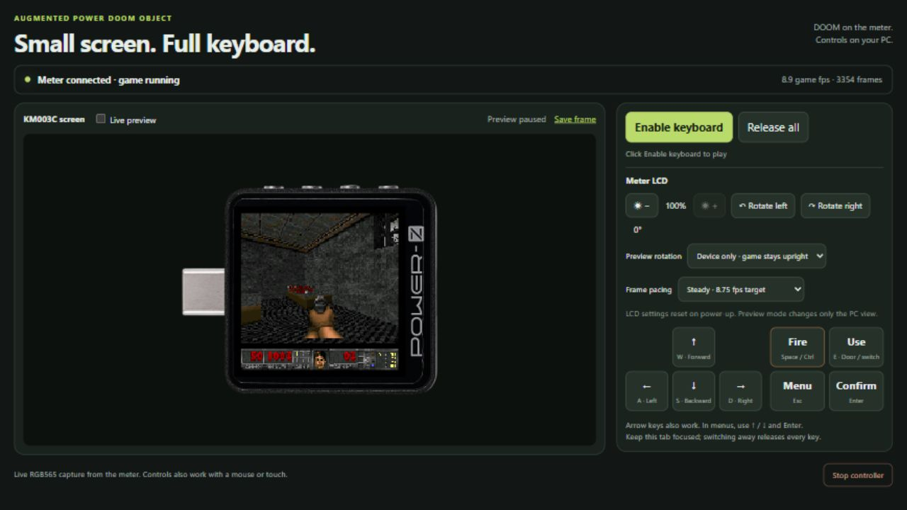

# APDO DOOM — 独立ファームウェア版

[English (main)](README.md)

本プロジェクトは **EPR（Extended Pixel Range）** 規格に準拠し、高負荷な戦闘シーンでは
**AVS（Adjustable Violence System）** によって暴力描写とフレームレートを100mHz単位で動的に最適化。
最終的に **APDO（Augmented Power DOOM Object）** としてKM003Cの画面へ出力される――。
（USB-PD用語を使ったジョークです。）

`main` はKM003C向けの独立DOOM専用ファームウェアです。
**実験版ファームウェアをPre-releaseで公開しています。** 旧v8とそのツールは
[legacyブランチ](https://github.com/inuchanbt/apdo-doom-on-km003c/tree/legacy)に保存しています。
既存の作業環境を更新する場合は[ブランチとツールの移行案内](docs/BRANCHES.md)を参照してください。

## ダウンロードとリスク

**HW2.1の不動作報告あり：** [利用者の報告](https://x.com/tomoca2/status/2116438041766375717)では、
**2023年9月製造のHW2.1でタイトル画面にてフリーズ**し、純正ファームへの復帰もエラーになったものの、
**強制DFUモードでは復旧できた**とのことです。使用したファームの版・原因は未確認で、本プロジェクトでの再現確認は行っていません。
**HW2.1は対応対象外です。HW2.3の照合を回避しないでください。** この個体での復旧成功は、他個体でも復旧できる保証ではありません。
詳細は[互換性の報告記録](docs/VALIDATION.md#external-hw21-failure-report)を参照してください。

[独立版 v0.1.0-independent をダウンロード](https://github.com/inuchanbt/apdo-doom-on-km003c/releases/tag/v0.1.0-independent)。
推奨の `-firmware.zip` に更新用 `.mencrypt`・通知・導入手順を同梱しています。別添のFreedoom E1M1データも必要です。
[導入手順](docs/INSTALL-PREBUILT.md)を先に読んでください。対応する全ソース、ライセンス通知、
リリース情報・SHA-256も同じReleaseに添付しています。自動生成のSource code ZIPだけでは
上流ソースが足りないため、明示的に添付した `-source.tar.gz` を利用してください。

**導入により本体が永久に使用不能になったり、工場出荷時のデータを失う可能性があります。
復旧は保証できず、修理・買い直しが必要になることもあります。**

- 確認したのは**純正2.0.7が入っていたHW2.3の1台だけ**です。他の版・個体の互換性は未検証です。
  照合に失敗した場合は強行しないでください。
- 純正アプリをDOOM専用アプリに置き換えるため、**導入中はUSB測定・PD交渉・純正テスターUIを使えません**。
- ゲーム導入で外部NORの先頭3MiBを書き換えます。**ファーム書き込み前に自分の個体の純正／DFU取得・検証と
  純正復旧パッケージ作成を済ませ、ゲームデータ書き込み前に元の外部NOR全4MiBを取得・検証**してください。
- 純正復帰には元のNOR内容と元のアプリの両方を、手順書の順序で戻す必要があります。
  純正アプリのファイルだけでは完全な復旧になりません。
- 書き込み中断・不具合・ハード違い・バックアップの取り違えにより復旧不能になることがあります。
  **2026-10-31に所有者が同じHW2.3個体で、新手順による初回導入・ゲームデータ書き込みから完全な純正復元まで
  確認できたと報告しています。** 他個体や故障時の復旧を保証するものではありません。
- **測定側の両端子を空にして側面HIDだけを接続**してください。ローダー／ICGや他個体の復旧データを
  書き込まないでください。

配布ファームには純正アプリ・ローダー・ICG・校正情報・個体識別情報を含めません。Freedoomロゴは含みますが、
プレイ用のゲームデータは別途必要です。`.mencrypt` は本プロジェクトの検証付きツールで書き込み・全域読み戻しを
確認しました。**メーカーのGUI更新ツールからの導入は未検証**です。メーカーの承認・サポートをうたうものではなく、本プロジェクトは無保証です。メーカー保証の扱いは未確認です。
詳しくは[リリース情報](docs/BINARY-RELEASE.md)を参照してください。

[実機デモ動画 — 60秒](docs/videos/apdo-doom-on-km003c.mp4)。動画は旧実装のものです。
独立版もゲーム処理はKM003C本体で行います。

## PCから遊ぶ

[導入手順](docs/INSTALL-PREBUILT.md)を済ませたら `scripts/play.ps1` を実行し、表示されたHTTPのURLを
普通のブラウザで開いて **Enable keyboard** を押します。サーバーは起動したままにしてください。
W/S・↑/↓で移動、A/D・←/→で旋回、Space/Ctrlで射撃、Eで扉・スイッチ、Escでメニュー、Enterで決定です。
本体の滑らかさを優先するときは **Live preview** をOFFにしてください。
[PC操作](docs/PC-CONTROLS.md)・[画面キャプチャ](docs/SCREEN-CAPTURE.md)の説明も参照できます。

このブランチのビルドは、ライセンス未確認の `okhsunrog/km003c-firmware` とその基板クレート、
生成済み `hc32f460-pac` を取得・リンクしません。基板起動・液晶／NOR・明るさ・ボタン・USBは
`independent/` に置き、クロック・割り込み・時刻管理はMIT許諾のあるHAL部分を出所明記で利用します。
既存の調査知識も使うため、厳密なクリーンルーム実装をうたうものではありません。

DOOMエンジン、Freedoom、正方形描画、キャッシュ、Steady、Web操作は引き継ぎます。
純正ローダーとの通信には、別途ライセンスが明示された固定版 `km003c-lib` を利用します。

[ビルド手順](docs/BUILD.md)と[実装・検証状況](docs/INDEPENDENT.md)を参照してください。
ファーム・PCツール・読み取り専用バックアップツールのビルドに、個体のバックアップは不要です。
**書き込み時には自分の個体で取得・検証した復旧データが必要**です。
PCツールは復旧データを実行時に読み、ローダーや個体シリアルを埋め込みません。
未改造個体の初回取得・ゲーム導入・順序を守った復元は [FIRST-BACKUP.md](docs/FIRST-BACKUP.md) を参照してください。
独立版での一連の導入・復元操作は、2026-10-31に所有者が実機確認を報告しています。
[検証記録](docs/VALIDATION.md)では、自動検査と所有者による確認を区別しています。

HW2.3／純正2.0.7以外の互換性は未確認です。書き込み中断・不具合・復旧データの取り違えにより
使用不能になる可能性があり、復旧を保証しません。導入・プレイ時は測定端子を空にし、側面HIDだけを接続してください。
DOOM版にはUSB測定・PD交渉・純正テスター画面はありません。元に戻すには純正アプリに加え、
校正／個体データを含む外部NORの復元が必要です。ローダーや他個体の復旧データを書き込まないでください。

出所とライセンスは [THIRD_PARTY_NOTICES.md](THIRD_PARTY_NOTICES.md) を参照してください。
旧overlay・基板パッチ・旧復旧ツールは `legacy` ブランチに保存しています。
旧版のツールや復旧コマンドは独立版と互換ではないため、この版の手順を使ってください。
