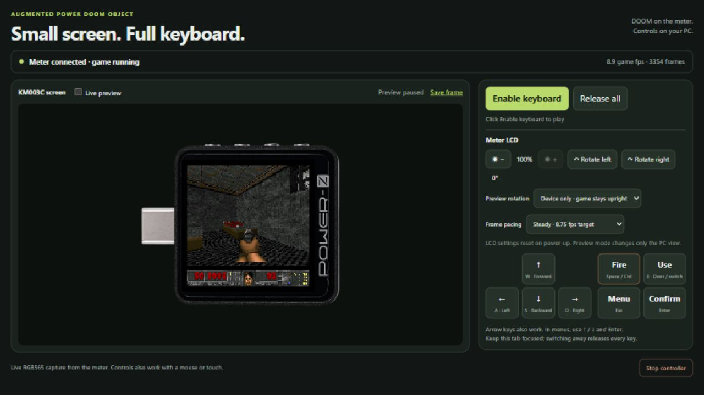

# APDO DOOM — independent firmware

[日本語](README.ja.md)

This project complies with **EPR (Extended Pixel Range)**. Under intense combat,
**AVS (Adjustable Violence System)** dynamically optimizes violence and frame rate
in 100 mHz increments, finally delivering an **APDO (Augmented Power DOOM Object)**
to the KM003C screen. (The USB-PD terminology is a joke.)

`main` contains the independent DOOM-only application for the KM003C.
**Experimental firmware is available as a Pre-release.** The previous v8
implementation and its tools are preserved on the [legacy branch](https://github.com/inuchanbt/apdo-doom-on-km003c/tree/legacy).
See [branch and tool migration](docs/BRANCHES.md) when updating an existing workspace.

## Experimental firmware download — read the risks first

[Download v0.1.2-independent — HW 2.3](https://github.com/inuchanbt/apdo-doom-on-km003c/releases/tag/v0.1.2-independent).
Open `START-HERE.md` in the Windows x64 ZIP. It includes the app, matching HID
host and Freedoom E1M1 game data.
Use the attached `-source.tar.gz` for matching project and dependency sources.

The new installer targets **HW 2.3** on stock FW 2.0.7. The historical
[v0.1.1 HW 2.1 trial](https://github.com/inuchanbt/apdo-doom-on-km003c/releases/tag/v0.1.1-independent)
remains available separately; its earlier trial reached gameplay on one collaborator's meter.
See [validation and compatibility](docs/VALIDATION.md#hw21-gameplay-report).

**Installing this can permanently disable your meter or lose factory data.
Recovery is not guaranteed; repair or replacement may be necessary.**

- Use stock FW 2.0.7 and the installer for the exact hardware revision.
  Stop if the installer reports a mismatch.
- This replaces the tester application with DOOM. **USB measurement, PD negotiation
  and the stock tester UI are unavailable while it is installed.**
- Game installation changes the first 3 MiB of external NOR. Acquire your own
  verified stock/DFU snapshots and restore package **before flashing**, then a full
  verified original 4 MiB NOR backup **before writing any game data**.
- Returning to stock requires the original NOR contents **and** original app in
  the documented order. A stock app file alone is not a complete rollback.
- Interrupted writes, wrong hardware, firmware bugs or mismatched backups may
  prevent recovery. On **2026-10-31**, the owner confirmed the independent
  first-install/game-data-write/complete-stock-restore workflow on the same
  HW2.3 unit. This does not guarantee recovery on another unit or after a failure.
- Connect **only the side HID port** and leave both measurement connectors empty.
  Never write a bootloader/ICG or use another unit's recovery data.

The update file contains no stock app, loader, ICG, calibration or device identifier.
The Windows installer writes the app and the included game pack in two stages.
Use the included installer for this release.
This is an unofficial, experimental project, supplied without project warranty; manufacturer approval/support is not claimed. See [release details](docs/BINARY-RELEASE.md).

[Watch KWS-X1 and KM003C running DOOM together — 60 seconds · MP4 · 6.9 MB](docs/videos/apdo-doom-on-km003c.mp4).
Both meters run the game and render on their own MCUs. The PC supplies controls
to both and game data to the [KWS-X1](https://github.com/inuchanbt/apdo-doom-on-kws-x1).

## Play from the PC

After completing the [installation guide](docs/INSTALL-PREBUILT.md), run
`scripts/play.ps1` and open its printed HTTP URL in a normal browser. Keep the
server running and click **Enable keyboard**. Use W/S or ↑/↓ to move, A/D or ←/→
to turn, Space/Ctrl to fire, E to use, Esc for the menu and Enter to confirm.
Turn off **Live preview** when prioritizing smooth motion on the meter.
See [PC controls](docs/PC-CONTROLS.md) and [screen capture](docs/SCREEN-CAPTURE.md).

v0.1.2 uses a shared generic HID USB identity. **Use the matching PC helper with
the new firmware.** The owner confirmed flashing and operation on 2026-11-11;
a complete install/restore round trip has not been repeated with this transport.
See [USB identity and migration](docs/USB-IDENTITY.md).

## What is independent?

The active build does not fetch or link `okhsunrog/km003c-firmware`, its board
crates, or the generated `hc32f460-pac`. Board startup, GPIO, panel/backlight,
shared LCD/NOR transport and the DOOM-only USB interface live in `independent/`.
An explicitly MIT-licensed subset of `hc32f460-embassy-rs` supplies checked clock
transitions, interrupt routing and TimerA timekeeping. It retains its attribution
and tests. This is not a claim of a clean-room implementation: hardware information
from the earlier investigation remains useful.

The GPL DOOM engine, Freedoom data, square projection, short-read cache, Steady
frame pacing and Web controller are retained. The host's native-loader transport
still uses the separately licensed, pinned `km003c-lib`.

## Build and recovery

See [BUILD.md](docs/BUILD.md) and the [implementation/provenance notes](docs/INDEPENDENT.md).
The firmware, host and read-only backup utility can be built without any device
backup. **Flashing still requires your own verified recovery material.** The new
host reads that material at runtime; it embeds neither a loader dump nor a serial.

Start an untouched meter with [FIRST-BACKUP.md](docs/FIRST-BACKUP.md).
It covers independent initial acquisition, game installation and ordered restoration.
The owner confirmed the complete independent install/restore sequence on
2026-10-31; [validation details](docs/VALIDATION.md) distinguish that report from
automated checks. Use the `legacy` branch only for the previous implementation;
its host tools and recovery commands are not interchangeable with this version.

## Hardware risks

Only HW2.3 / stock 2.0.7 recovery has been investigated. Unsupported revisions,
interrupted writes, firmware bugs or a mismatched backup can leave the meter
unusable; recovery is not guaranteed. Keep measurement connectors empty and use
only the side HID connection during installation and play. This firmware does not
provide USB measurements, PD negotiation or the stock tester UI. Restoring those
features requires the original application and external NOR contents, including
calibration/device data. Never flash a bootloader or another unit's recovery dump.

## Status and license

Check [INDEPENDENT.md](docs/INDEPENDENT.md) for the recorded validation status.
The release pairs the tested application with corresponding source and license
notices; it does not make the legacy v8 binary redistributable or guarantee
installation/recovery. See [third-party notices](THIRD_PARTY_NOTICES.md).

## Acknowledgments

Thank you to project contributor [tomoca2 (@tomoca2)](https://x.com/tomoca2) for testing the HW 2.1 Windows installer on a physical KM003C, providing the read-only compatibility report, and sharing the video of the game running.
