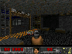

# KM003C screen capture

Firmware **2.0.7-doom6 (v6)** adds a live PC preview to the keyboard controller. It captures the actual RGB565 pixels passed to the meter's LCD output, downsamples them to **120×90**, and transfers consistent snapshots over USB. The game continues to execute on the KM003C.



*Actual device capture, not the host test renderer. The controller enlarges this 120×90 image.*

## Use

```powershell
.\scripts\play.ps1
```

The existing local controller now shows the captured game image inside the supplied KM003C enclosure image. The enclosure is rotated 90 degrees counterclockwise, placing the Type-C connector on the left; the game remains upright. The square display area preserves the game's 4:3 aspect ratio with black bars, matching the meter's game-area layout. Click **Enable keyboard** to play from the PC as before. **Save frame** downloads the latest image as a lossless RGB565 BMP. The browser enlarges the preview with nearest-neighbor pixel display; the transferred image itself is 120×90. Uncheck **Live preview** to stop image transfers while keeping keyboard control and the latest captured image.

Use one controller process at a time. The HTTP service remains loopback-only, and existing key-release-on-blur and input leases remain active during capture. A preview failure does not stop the input task.

## What is captured

The game uses a column renderer rather than keeping a full 240×180 framebuffer in MCU RAM. A software shadow records the LCD's game-area output, sampling every other displayed pixel in each direction. It includes HUD and menu updates, including regions that are not redrawn every game frame.

This is a capture of the DOOM application's LCD output path. It does not read the ST7789 controller's internal GRAM, inspect arbitrary memory, or capture the stock firmware's UI. The display's unused black top/bottom borders are outside the preview.

## Consistent frames and memory

Two 21,600-byte buffers are used. Rendering continuously updates the live buffer. The capture RPC copies it into a frozen buffer between game-rendering calls; all chunks refer to the same snapshot generation. Later rendering cannot alter that snapshot. A mismatched generation or out-of-bounds request is rejected.

The linked v6 image uses 102,268 bytes of BSS and 676 bytes of initialized data in the existing approximately 128 KiB main RAM region. It leaves roughly 27 KiB for the stack. The memory map and engine scratch allocation remain unchanged. No additional flash storage is written for captures.

The host queues six bounded 4 KiB reads concurrently while the independent input task keeps renewing keys. The firmware leaves an 8 ms USB scheduling window between rendered frames while capture traffic is active, returning to its 1 ms window when capture stops. This avoids pausing the game for a whole transfer.

## Performance

The panel reports the meter's render rate and the preview's update rate separately. They are different measurements: the game continues rendering while an older frozen image is transferred. Preview speed and delay depend on USB scheduling and scene cost. This is a small diagnostic preview rather than a PC-rate video stream.

The first sequential-read prototype measured approximately 0.6–0.7 preview fps with roughly 1.4-second transfers. Pipelined reads measured approximately **1.5 preview fps and 0.55-second transfers** in the initial E1M1 scene. Image traffic also reduces the game's rendered-frame cadence; turn off **Live preview** when prioritizing play on the meter. Rates depend on the scene and USB scheduling. The game-rate label is measured from the device's rendered-frame counter, rather than inferred from the cost of one drawing call.

## Verification

Tests exercise coordinate mapping, clipping, persistence of partially redrawn regions, immutable snapshots, stale generations, chunk bounds, RGB565 byte order, top-down BMP orientation, row padding, and invalid image payloads. The update is verified by full application readback and unchanged native-loader checks. Local image and transport evidence is stored under ignored `artifacts/`.

The user confirmed that the device's game image updates on the PC and that keyboard actions are reflected in that image. Pausing preview transfers was also verified while the game and input connection remained active.

The HTTP API serves the latest completed BMP at `/api/frame.bmp`. It exposes the bounded game image, not workspace files or recovery backups. Python uses only its standard library to construct the BMP; Pillow is not required for playing or saving images.
